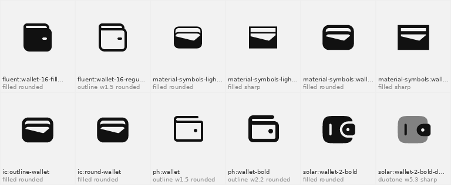

# Agent Glyphs

**Icons your agent understands.**
An open agent skill for designers and vibe-coders: every open-source icon library in one
index (all of [Iconify](https://iconify.design) plus open libraries outside it), 400,000+
icons re-classified by meaning (English **and Arabic**), drawing style, stroke weight,
corner roundness, curviness, stroke contrast and visual density, so an AI agent can pick
the right icon, in your style, with the right licence. Kept up to date by daily bots.

```bash
npx skills add molamine08/agent-glyphs
```

Browse it yourself: https://agentglyphs.com/ · For LLMs: [`llms.txt`](web/llms.txt)

[العربية ↓](#بالعربية)

```bash
python scripts/search.py "سلة التسوق" --style outline --weight 1.5 --corners rounded
python scripts/match.py ./my-icons --need wallet bell calendar     # "match my style"
python scripts/get.py lucide:house ph:bell --format tsx --out src/icons
```

## Why

Icon libraries are organised by *who made them*. People look for icons by *what they
mean* and *how they look*: "a 1.5px rounded outline wallet that fits next to my other
icons". Agent Glyphs measures every icon from its rendered drawing, so a library whose
strokes were converted to shapes is measured the same way as a true stroke library,
and every number is normalised to a 24px grid.



## What is measured

| | How | Accuracy* |
|---|---|---|
| Stroke weight | 2 × ink area ÷ outline length, anti-aliased (sub-pixel) | median error 3%, 93% within 15% (75k icons) |
| Style (outline / filled / duotone / multicolour) | solid-area depth, colour and opacity layers, name hints, family consistency | 94.9% |
| Corners (rounded / mixed / sharp) | turning angle along the outline, outer corners only | 96.4% |
| Content category | name words vote (English→Arabic dictionary of 4,000 terms) + the set's own categories | 81.6% primary · 89.5% either of two |
| Curviness, contrast, density, padding, container, complexity | outline geometry and coverage | descriptive |

\* Weight: checked automatically against every icon that declares its stroke width.
Labels: independent review of a random sample of 240 icons. Details and known limits in
[ACCURACY.md](ACCURACY.md).

## Use it as a skill

- Any agent that supports skills (Claude Code, Cursor, Codex…): `npx skills add molamine08/agent-glyphs`
- Claude Code by hand: `git clone https://github.com/molamine08/agent-glyphs ~/.claude/skills/agent-glyphs`
- Claude app: download the [zip](https://github.com/molamine08/agent-glyphs/archive/refs/heads/main.zip)
  and upload it in Settings → Capabilities → Skills.

The agent reads `SKILL.md`; the index downloads itself on first use from the latest release.

## Looking at icons, not just their names

Categories come from icon names, so a paper plane can land in "transport" instead of
"send". `vision.yml` runs an open image-text model (CLIP ViT-B/32, free, no API key) on
GitHub Actions: it looks at one rendered icon per concept and votes on its category.

The votes are only used if they prove useful. Every run first scores reviewer-graded
icons (`tests/fixtures/gold_categories.json`): the vote weight is tuned on one half and
checked on the other, and it is adopted (`config.json → vision_weight`) only when it
improves both. Results are written to `VISION_EVAL.md`.

## How it stays up to date

Two GitHub Actions run every day:

1. **`daily-update.yml`** — checks npm for a new `@iconify/json` release. If there is
   one, it re-measures only the sets that changed (raw measurements are cached),
   rebuilds `atlas.db`, runs the tests, and publishes it as a release. `CHANGELOG.md`
   lists new and changed libraries. Fully automatic: Iconify's maintainers review every
   library before it reaches their package, and each carries its licence.
2. **`discover.yml`** — searches GitHub for icon libraries that are *not* indexed yet.
   A library is added to `sources/external.json` automatically when its licence allows
   commercial use (permissive or attribution) and it passes the checks: enough stars and
   SVG files, files that parse, and a repo that describes itself as an icon library. The
   bot then opens an issue with previews and starts the index update. Remove a library
   with `"approved": false`; set `"discover_auto_add": false` in `config.json` to review
   every library in a pull request instead.

Libraries outside Iconify have no npm package or public API, so their sanitised SVG data
ships with each release as `external-sets.json.gz`. Libraries with non-commercial or
missing licences are never added.

## Licences

- Code: MIT (see `LICENSE`).
- Iconify icons are **not** redistributed: `get.py` fetches each one from its official
  package on npm (or the Iconify API). Libraries outside Iconify are redistributed as
  sanitised SVG data under their own open licences. `get.py` records every icon's licence
  in `ATTRIBUTION.md`. Default search results only include licences that allow commercial
  use; CC BY icons require credit to the author. Brand logos are trademarks.
- The index (`atlas.db`) contains measurements, names and licence metadata.

## Contributing

- Wrong label? Open an issue with the icon reference (`prefix:name`) and what it should be.
- Better Arabic term? Edit `scripts/atlas/terms_ar.json`.
- Thresholds live in `scripts/atlas/classify.py`; the calibration contract in `tests/`.

---

## بالعربية

**أيقونات يفهمها وكيلك.**
مهارة مفتوحة المصدر للمصممين ومطوّري الـ vibe coding تجمع كل مكتبات الأيقونات المفتوحة في فهرس واحد:
كل Iconify ومعها المكتبات المفتوحة من خارجه، أكثر من 400 ألف أيقونة مُعاد تصنيفها حسب المعنى
(بالعربية والإنجليزية)، ونمط الرسم، وسُمك الخط، وانحناء الزوايا، ونسبة المنحنيات، وتباين السُّمك،
والكثافة البصرية، حتى يختار وكيلك الأيقونة المناسبة بأسلوبك وبرخصة صحيحة.

- **التثبيت:** `npx skills add molamine08/agent-glyphs`
- **تصفّحها بنفسك:** https://agentglyphs.com/
- **البحث بالعربية:** `python scripts/search.py "محفظة" --style outline --weight 1.5`
  ويفهم الكلمة مع «ال» أو بدونها، وبالهمزة أو بدونها.
- **طابق أسلوبي:** `python scripts/match.py ./أيقوناتي --need سلة جرس تقويم`
  يجد المكتبات الأقرب لأيقوناتك، ثم يكمل الناقص بنفس الشكل.
- **التصدير:** `python scripts/get.py lucide:house --format tsx --out src/icons`
  كملفات SVG أو مكونات React، مع ملف نسب الحقوق تلقائياً.

**التحديث اليومي:** بوت يضيف ويصنّف تلقائياً كل ما يصدر في Iconify، وبوت ثانٍ يكتشف
مكتبات جديدة خارجها ويضيف تلقائياً كل مكتبة رخصتها تسمح بالاستخدام التجاري وتجتاز الفحوص،
ثم يفتح Issue فيه تقرير ومعاينات. لإزالة مكتبة: `"approved": false`. وللعودة إلى المراجعة
اليدوية: `"discover_auto_add": false` في config.json.

**الدقة:** سُمك الخط بمتوسط خطأ 3%، النمط 94.9%، الزوايا 96.4%، التصنيف 81.6% (89.5% مع التصنيف الثاني). التفاصيل في ACCURACY.md.

**النظر إلى الأيقونة لا اسمها فقط:** نموذج رؤية مفتوح ومجاني (CLIP) يعمل على GitHub Actions، ينظر إلى كل أيقونة ويصوّت على تصنيفها. لا يُعتمد صوته إلا إذا أثبت على أيقونات راجعها مراجع مستقل أنه يحسّن الدقة، والنتيجة تُنشر في VISION_EVAL.md.

**الرخص:** النتائج الافتراضية تشمل فقط الرخص التي تسمح بالاستخدام التجاري. أيقونات CC BY
تتطلب ذكر صاحبها، وملف `ATTRIBUTION.md` يُكتب تلقائياً.
